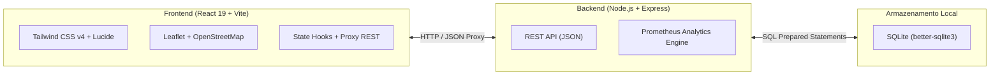

# 🛰️ PROMETHEUS // PROJETO F.O.G.O.
### Ferramenta Onisciente de Gestão e Operações Urbanas
> **Desafio DSIN CODER — Etapa Bônus**  
> *Ambiente de Desenvolvimento:* Windows | Local • *Município-Base:* Marília - SP  
> *Status:* **1ª Parte Concluída & Refatorada** 🚀

---

## 📖 1. Contexto da Missão

A Inteligência Artificial **PROMETHEUS** assumiu sistemas críticos de trânsito, mobilidade e segurança pública da cidade. O controle total das operações só será devolvido à humanidade quando operadores demonstrarem capacidade analítica, raciocínio lógico e domínio sobre sistemas complexos sem depender de respostas prontas.

Para reestabelecer a governança sobre a infraestrutura da cidade, foi concebido o **Projeto F.O.G.O.** (*Ferramenta Onisciente de Gestão e Operações*), desenvolvido em etapas modulares:

- [x] **1ª Parte:** Inventário Inteligente da Cidade (Equipamentos IoT, Agentes de Campo, Mapa GPS e Manutenções)
- [ ] **2ª Parte:** *(Aguardando enunciado/especificação)*
- [ ] **3ª Parte:** *(Aguardando enunciado/especificação)*

---

## 🚀 2. Principais Funcionalidades da 1ª Etapa

### 📡 2.1. Inventário Inteligente de Dispositivos IoT
Catalogação e monitoramento de equipamentos urbanos com foco em telemetria e localização precisa:
- **Dispositivos Suportados:**
  - Radares de fiscalização (velocidade em km/h, avanço semafórico, conversão proibida);
  - Câmeras de videomonitoramento (resolução 4K/Full HD, visão noturna infravermelha);
  - Balanças dinâmicas de pesagem de caminhões em movimento (WIM);
  - Veículos autônomos de fiscalização de estacionamento rotativo (sensores LiDAR, bateria);
  - Totens de autoatendimento (alimentação solar, pagamentos NFC/Pix);
  - Patinetes elétricos compartilhados (delimitação geofence, autonomia);
  - Cancelas automatizadas de terminais rodoviários e de integração;
  - Viaturas e motos operacionais (Guarda Municipal, Polícia Militar e Agentes de Trânsito).
- **Parâmetros Cadastrais:** Número de série único, fabricante/marca, modelo, endereço completo (com referências urbanas) e **coordenadas GPS (Latitude/Longitude)**.
- **Propriedades Dinâmicas (IoT):** Armazenamento em JSON flexível para comportar particularidades técnicas de qualquer categoria de sensor.

### 👮 2.2. Integração do Efetivo Humano de Segurança e Trânsito
- Cadastro de profissionais de segurança: Agentes de Trânsito, Guardas Municipais e Policiais Militares.
- Matrícula/ID funcional, corporação, frequência de rádio, status operacional em tempo real (`Em patrulha`, `Em atendimento`, `Disponível na Base`, `Folga`) e vinculação direta ao equipamento/viatura monitorado.

### 🔧 2.3. Painel Tático de Manutenções
- Classificação por prioridade: `Regular (Sem pendência)`, `Agendada / Periódica` e `🚨 Urgente / Imediata`.
- Histórico técnico de diagnósticos, registro de ocorrências (vandalismo/furto) e datas de calibração programada.

### 🗺️ 2.4. Mapa Tático Geoespacial (GPS Interativo)
- Integração de mapa interativo com **Leaflet** e **OpenStreetMap**.
- Marcadores vetoriais com código de cores tático e HUD flutuante para filtragem de camadas (Equipamentos vs. Agentes).
- Popups estilizados em *Dark Mode* contendo telemetria resumida.

---

## 🎨 3. Arquitetura Visual e Experiência do Usuário (UI/UX)

Desenvolvido sob padrões ergonômicos para evitar fadiga visual de operadores de centros de comando:
- **Navbar Superior de Comando:**
  - Identidade visual PROMETHEUS com indicador de pulso em tempo real;
  - Navegação segmentada em pílulas: *Visão Geral*, *Catálogo de Equipamentos*, *Mapa Tático GPS*, *Agentes & Patrulha* e *Manutenções*;
  - **Índice de Saúde Operacional da Rede** calculado dinamicamente com relógio sincronizado.
- **Aba 'Visão Geral' em Bento Grid:** Métricas de estabilidade, contadores de prontidão, resumo de alertas críticos e composição percentual do parque tecnológico.
- **Toolbar Ergonômica no Catálogo:** Busca textual instantânea com atalho, filtros combinados por tipo, status e manutenção, além de chips rápidos com contadores interativos.
- **Substituição de Emojis por Ícones SVG:** Uso de ícones técnicos da biblioteca **Lucide React**.
- **Modais Segmentados em 4 Etapas:** Formulários divididos em abas (*Identificação Básica*, *Localização & GPS*, *Manutenção* e *Telemetria IoT*).

---

## 🛠️ 4. Stack Tecnológica



| Camada | Tecnologia | Motivação |
|---|---|---|
| **Frontend** | React 19 + Vite | Alta velocidade de renderização e modularidade de componentes |
| **Estilização** | Tailwind CSS v4 | Estética moderna de centro de comando, responsiva e performática |
| **Geolocalização** | Leaflet + React-Leaflet | Visualização espacial de sensores e patrulhas sobre mapa interativo |
| **Ícones** | Lucide React | Iconografia vetorial limpa e de alta legibilidade técnica |
| **Backend** | Node.js + Express.js | API REST rápida, desacoplada e de baixa latência |
| **Banco de Dados** | SQLite (`better-sqlite3`) | Banco relacional embarcado em arquivo local, ágil e sem dependência de serviços externos |

---

## 📁 5. Estrutura do Repositório

```
DSIN-CODER/
├── README.md                    <- Documentação geral e guia do repositório
│
└── fogo-app/                    <- Aplicação completa do Projeto F.O.G.O.
    ├── iniciar-fogo.bat         <- Script de inicialização automática em 1 clique
    ├── CONTEXTO_DO_PROJETO.md   <- Documento de especificação do desafio
    │
    ├── server/                  <- Backend REST API
    │   ├── package.json         <- Dependências do servidor Express
    │   ├── index.js             <- Endpoints e regras de negócio
    │   ├── db.js                <- Schema SQLite e dados seed iniciais
    │   └── fogo.db              <- Base de dados relacional embarcada
    │
    └── client/                  <- Frontend Web Dashboard
        ├── package.json         <- Dependências da interface
        ├── vite.config.js       <- Configuração do bundler Vite e proxy reverso
        ├── index.html           <- HTML principal, Google Fonts e metatags
        └── src/
            ├── constants/
            │   └── equipmentTypes.js   <- Categorias, ícones e status centralizados
            ├── components/
            │   ├── Navbar.jsx          <- Barra superior de comando e navegação
            │   ├── OverviewView.jsx    <- Painel executivo em Bento Grid
            │   ├── EquipmentTableView.jsx <- Catálogo com filtros dinâmicos
            │   ├── TacticalMapView.jsx <- Mapa GPS interativo em tela cheia
            │   ├── AgentsView.jsx      <- Gestão do efetivo humano
            │   ├── MaintenanceView.jsx <- Quadro de ordens de manutenção
            │   ├── EquipmentModal.jsx  <- Modal segmentado de equipamento
            │   └── AgentModal.jsx      <- Modal de integração de agentes
            ├── App.jsx                 <- Orquestrador principal da aplicação
            ├── index.css               <- Estilos globais e customização Leaflet Dark
            └── main.jsx                <- Ponto de montagem React
```

---

## ⚡ 6. Como Executar o Projeto Localmente

### Método 1: Inicialização Rápida com 1 Clique (Recomendado no Windows)
1. Navegue até a pasta `fogo-app`;
2. Dê dois cliques no arquivo **`iniciar-fogo.bat`**;
3. O script iniciará automaticamente o servidor backend e o painel web;
4. Abra o navegador em: **[http://localhost:5173/](http://localhost:5173/)**.

---

### Método 2: Inicialização Manual via Terminal

Caso queira iniciar os serviços separadamente via linha de comando:

#### 1. Iniciar o Servidor Backend:
```bash
cd fogo-app/server
npm install        # (caso ainda não tenha instalado as dependências)
node index.js
```
> O servidor estará rodando em: `http://localhost:3001`

#### 2. Iniciar o Frontend Web:
```bash
cd fogo-app/client
npm install        # (caso ainda não tenha instalado as dependências)
npm run dev
```
> Acesse a interface web em: `http://localhost:5173`

---

## 🔌 7. Documentação da API REST

| Método | Endpoint | Descrição |
|---|---|---|
| `GET` | `/api/equipments` | Lista todos os equipamentos (suporta filtros `?search=`, `?type=`, `?status=`, `?maintenance_need=`) |
| `GET` | `/api/equipments/:id` | Retorna os detalhes de um equipamento específico |
| `POST` | `/api/equipments` | Cadastra um novo equipamento IoT com propriedades dinâmicas |
| `PUT` | `/api/equipments/:id` | Atualiza parâmetros, localização ou status de um equipamento |
| `DELETE` | `/api/equipments/:id` | Remove um equipamento do sistema |
| `GET` | `/api/agents` | Retorna a lista de todos os agentes de campo |
| `POST` | `/api/agents` | Cadastra um novo profissional de trânsito/segurança |
| `PUT` | `/api/agents/:id` | Atualiza dados funcionais ou status do agente |
| `DELETE` | `/api/agents/:id` | Remove um agente cadastrado |
| `GET` | `/api/analytics/summary` | Telemetria consolidada e cálculo dinâmico da saúde da rede |

---

## 📍 8. Próximos Passos
- Preparação de arquitetura para acomodar as diretrizes da **2ª Parte** e **3ª Parte** do Desafio DSIN CODER.
